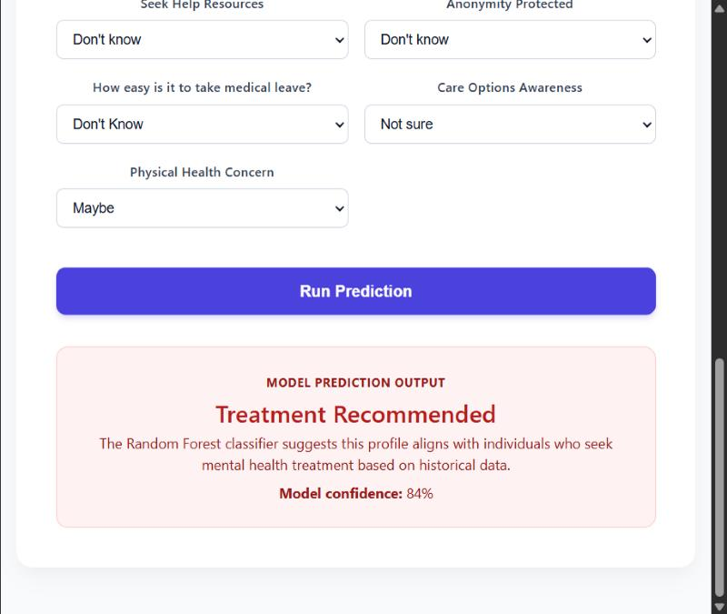

# Mental Health Treatment Prediction – Web App

React interface for a machine-learning model that predicts whether a tech worker is likely to seek mental health treatment, based on their workplace and personal circumstances.

**Live demo:** [mental-health-project-frontend-jet.vercel.app](https://mental-health-project-frontend-jet.vercel.app) · **Backend / model repo:** [Mental_health_project_backend](https://github.com/Danishh-ux/Mental_health_project_backend)

<p align="center"></p>

## How it works

1. The user answers 14 questions about themselves and their workplace (age, gender, company size, benefits, medical leave, how much mental health interferes with work, and more).
2. The app sends the answers to a **FastAPI** service hosted on **Hugging Face Spaces** (Docker).
3. A **Random Forest** model (82.8% test accuracy, 0.90 ROC-AUC) trained on the OSMI Mental Health in Tech survey returns a prediction and its confidence, which the app displays.

```
React (Vercel)  ──POST /predict──▶  FastAPI + scikit-learn (Hugging Face Spaces)
```

## Tech stack

React 19 · Vite · JavaScript · deployed on Vercel. The backend is Python, FastAPI, scikit-learn and Docker.

## Run locally

```bash
cd Mental_health_frontend/react-app
npm install
npm run dev
```

The app calls the hosted API by default. To use a local backend, run it (see the backend repo) and enter `http://localhost:7860/predict` in the API URL field at the top of the page.

## Disclaimer

Educational project. Predictions describe patterns in survey data and are **not** a medical or psychological assessment.
